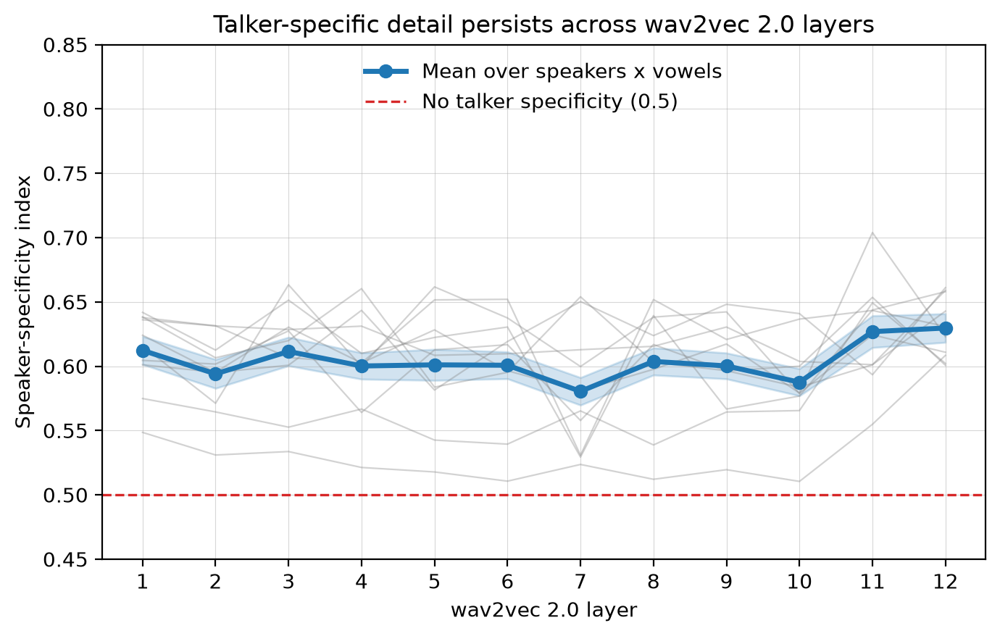

# Talker Decoding

Probing how self-supervised speech models (wav2vec 2.0, WavLM, HuBERT, Whisper)
represent **talker identity** vs. **phonetic content** across their layers. The
pipeline extracts per-layer hidden states for LibriSpeech vowels, aligns them
with phone- and formant-level acoustic annotations, and quantifies talker vs.
phone structure three ways: **linear / FFN decoding**, a **speaker-specificity
KLD index**, and **RSA** against acoustic RDMs.



*Speaker-specificity index (a KL-divergence ratio: 1 = a layer tracks each
talker's **own** vowel acoustics, 0.5 = only talker-independent phonetic
category) sits above 0.5 at every wav2vec 2.0 layer — talker-specific detail is
preserved throughout the network, dipping slightly mid-stack and rising again
at the top. Thin grey lines are individual vowels. Regenerate with
`python docs/make_figure.py`.*

## Repository layout

```
talker-decoding/
├── README.md               This file
├── requirements.txt        pip install -r requirements.txt  (mirrors environment.yml)
├── environment.yml         Conda environment (Python 3.12 + torch/transformers/sklearn)
├── docs/
│   ├── make_figure.py      Plots the speaker-specificity index across layers
│   └── talker_specificity_across_layers.png
├── scripts/
│   ├── download_data.sh    Fetch LibriSpeech dev-clean from OpenSLR
│   └── convert_flac_to_wav.sh  Recursively convert the corpus to 16 kHz .wav
├── src/                    Reproducible pipeline (run from inside this directory)
│   ├── run_pipeline.py     ★ Single entry point that chains the stages below
│   ├── get_waveform.py · extract_embeddings.py · readout_activation_leftjoin_annotation.py
│   ├── {logistic_regression,ffn}_{talker,phone}_decoding.py   Per-layer decoders
│   ├── compute_spec_idx.py Speaker-specificity index (KLD ratio) by layer
│   ├── compute_rsa.py      RSA of model layers vs. acoustic RDMs
│   ├── get_phone_tier.py · create_textgrid_write_interval_tier.py   Annotation prep
│   ├── acoustics.py · activations.py · decoding.py · spec_idx.py    Shared libraries
│   └── exploratory/        Analysis / scratch scripts (hard-coded paths; see its README)
├── R/                      R analysis (KLD visualization + mixed-effects models)
├── results/                Small tracked result tables (CSV)
└── data/                   Git-ignored; created by download_data.sh + the pipeline
    ├── raw/                LibriSpeech dev-clean (.wav + MFA TextGrids)
    └── processed/          Hidden states, decoders, intermediate tables
```

Large, regenerable artifacts are intentionally **not** stored in this repo: the
raw corpus is downloaded, and all hidden states, embeddings, decoder
coefficients, and figures are produced by running the code.

## Setup

Conda (recommended — pins the torch/OpenMP stack):

```bash
conda env create -f environment.yml
conda activate audio
```

or pip:

```bash
python -m venv .venv && source .venv/bin/activate
pip install -r requirements.txt
```

## Getting the data

The project uses **LibriSpeech dev-clean** (https://www.openslr.org/12/).

```bash
bash scripts/download_data.sh
```

LibriSpeech ships as `.flac`. The pipeline expects 16 kHz `.wav` plus Montreal
Forced Aligner (MFA) `.TextGrid` files per utterance. To reproduce the
`data/raw/dev-clean/<speaker>/<chapter>/*.wav + *.TextGrid` layout:

1. Convert `.flac` → `.wav` — `bash scripts/convert_flac_to_wav.sh`
2. Write sentence-tier TextGrids for the aligner —
   `cd src && python create_textgrid_write_interval_tier.py --corpus-root ../data/raw/dev-clean`
3. Force-align with MFA to produce the per-phone `.TextGrid` files.
4. Build the **annotation table** — a per-frame pickle keyed by
   `(filename, time)` carrying `phone`, `speaker`, and formants `f1/f2/f3`
   (`get_phone_tier.py` for phones, `acoustics.get_formant` for formants). The
   pipeline takes this as `--annotation`; it does not run forced alignment.

## Running the pipeline

> **Convention:** `src/` scripts import their sibling modules directly
> (`from acoustics import ...`, `from decoding import ...`) and write
> intermediate files relative to the working directory, so run them from
> **inside `src/`** (`cd src`). Outputs land under `data/processed/`. Shared
> code lives in `acoustics.py`, `activations.py`, `decoding.py`, `spec_idx.py`.

### One command, start to finish

`src/run_pipeline.py` chains **seven stages** —
`waveform → embeddings → readout → decode → spec_idx → figure → rsa` — skipping
any stage whose output already exists:

```bash
cd src
# Preview the exact commands without running anything:
python run_pipeline.py \
    --audio-root ../data/raw/dev-clean \
    --annotation ../data/processed/formant.pkl \
    --dry-run

# Real run (writes under ../data/processed/):
python run_pipeline.py \
    --audio-root ../data/raw/dev-clean \
    --annotation ../data/processed/formant.pkl
```

Useful flags: `--stages decode,spec_idx,rsa` to run a subset; `--decoder ffn` to
decode the talker with a feed-forward net instead of logistic regression
(default `logreg`; outputs are named `talker_auc_<decoder>.{csv,png}` so the two
never collide); `--force` to rerun completed stages; `--model` to swap in
another HF model; `--help` for everything.

### The seven stages

Each stage is also a normal CLI you can run on its own (`--help` on any):

1. **waveform** — `get_waveform.py` reads `.wav` files into an `audio_df` pickle.
2. **embeddings** — `extract_embeddings.py` dumps per-layer hidden states for
   wav2vec 2.0 / WavLM / HuBERT / Whisper.
3. **readout** — `readout_activation_leftjoin_annotation.py` left-joins
   activations with the annotation table, one pickle per layer.
4. **decode** — talker AUC by layer, via
   `logistic_regression_talker_decoding.py` or `ffn_talker_decoding.py` (the two
   `--decoder` choices). Phone counterparts:
   `logistic_regression_phone_decoding.py`, `ffn_phone_decoding.py`.
5. **spec_idx** — `compute_spec_idx.py` writes the per-layer speaker-specificity
   index: a KL-divergence ratio of how closely a layer tracks each talker's own
   vowel acoustics vs. the talker-independent marginal (the headline measure;
   logic in `spec_idx.py`). One `layer_<L>_spec_idx.csv` per layer, same format
   as the tracked `results/results_spec_idx/` tables.
6. **figure** — `docs/make_figure.py` plots the spec_idx across layers.
7. **rsa** — `compute_rsa.py` correlates each layer's per-speaker phone RDM with
   the speaker-specific and marginal formant RDMs, writing
   `marginal_cors_across_layers.csv` / `spec_cors_across_layers.csv` + a figure
   (needs `rsatoolbox`).

Standalone examples:

```bash
cd src
python compute_spec_idx.py --formant_df ../data/processed/formant.pkl \
    --hid-act-folder ../data/processed/hidden_states --out-dir ../data/processed/spec_idx
python compute_rsa.py --formant_df ../data/processed/formant.pkl \
    --hid-pkl-folder ../data/processed/hidden_acts_pkl --out-dir ../data/processed/rsa
python ../docs/make_figure.py   # defaults to the tracked results/ tables
```

## Further analysis

- **R** — `R/visualize_kld.Rmd` (with `R/helpers.R`) produces the per-vowel /
  per-speaker KLD plots and the mixed-effects models (`lmerTest`) over the
  exported result tables.
- **Exploratory** — `src/exploratory/` holds the representational-rotation,
  cosine-geometry, gammatone-baseline, and stimulus-selection scripts. They
  encode real method detail but run top-level code with hard-coded paths; see
  `src/exploratory/README.md`.

## External tools

- **Montreal Forced Aligner (MFA)** — phone-level forced alignment.
- **ffmpeg** — used by `scripts/convert_flac_to_wav.sh` for the `.flac` → 16 kHz
  `.wav` conversion.
